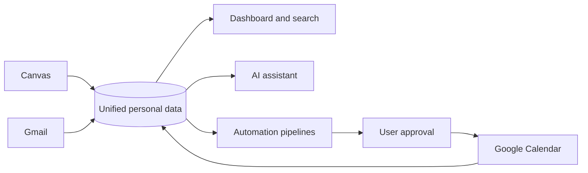
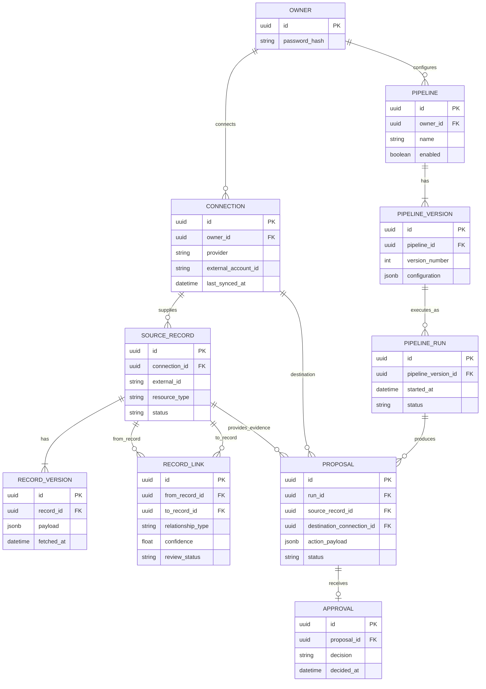
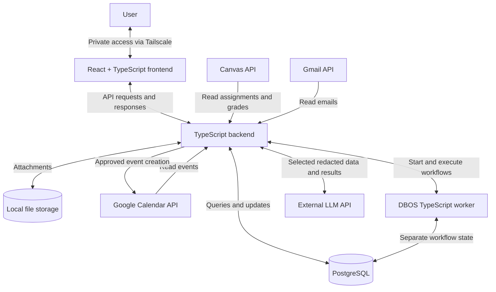

# Personal AI Assistant — Database Design Project

## 1. Project purpose and goals

Important personal information is scattered across applications such as Canvas, Gmail, and Google Calendar. I want to build a locally hosted personal assistant that connects these applications and makes their data accessible in one place without replacing them.

The main goals are to:

- **Aggregate information:** Store a local copy of connected application data in PostgreSQL, including its source and change history.
- **Make information accessible:** Provide a customizable widget dashboard, normal search, and an AI assistant that can answer questions about the data.
- **Connect information:** Use automated pipelines to find relationships between records from different applications and propose useful actions.

For example, I could ask what assignments are due this week, or the assistant could identify a meeting mentioned in an email, check my calendar for duplicates, and ask permission to add it.



The initial focus is Canvas assignments and an email-to-calendar pipeline. Finance, health, and other integrations are future possibilities.

## 2. Initial ERD

The database will use relational tables for shared information and relationships, with PostgreSQL's JSONB type for data that varies by integration (such as an email body or assignment deadline).



- **Connection:** An external account, such as my Canvas or Gmail account.
- **Source record and version:** An assignment, email, or event and its observed change history. The combination of connection, resource type, and external ID uniquely identifies a record.
- **Record link:** A relationship between two records, such as an email referring to an existing calendar event.
- **Pipeline, version, and run:** An automation, its saved configuration, and an individual execution.
- **Proposal and approval:** A suggested external change and the user's decision. Not every pipeline run needs to propose an action.

This is a first-pass ERD, not the final schema. It focuses on integrations and the email-to-calendar workflow. Dashboard layouts, conversations, reminders, local assignment completion, attachments, standing permissions, and detailed action auditing will need additional tables.

## 3. Rough system design



The backend handles synchronization, validation, permissions, and access to the database. The frontend and automated pipelines use the same backend services. DBOS manages workflow execution and recovery. The AI assistant uses controlled tools rather than direct database or account access.

## 4. Initial daily goals

Tentative schedule: November 18–December 11, 2026. December 11 is a planning assumption, not a confirmed class end date. Weekends and the Thanksgiving break are catch-up or rest days. Prioritize a working database and a small end-to-end demonstration over implementing the entire application.

| Date | Goal |
| --- | --- |
| Nov 18 | Submit the project proposal and initial diagrams. |
| Nov 19 | Identify required data fields and obtain representative Canvas, Gmail, and Calendar payloads. |
| Nov 20 | Refine the ERD, keys, cardinalities, and constraints. |
| Nov 23 | Set up PostgreSQL and write initial schema migrations. |
| Nov 24 | Seed test data and write basic joins and queries. |
| Nov 25 | Implement source record storage, versioning, and duplicate prevention. |
| Nov 26–29 | Break / catch-up. |
| Nov 30 | Connect to Canvas and import assignments, if account access permits. |
| Dec 1 | Query upcoming assignments and build a basic school dashboard. |
| Dec 2 | Implement Gmail and Calendar ingestion or use representative test data. |
| Dec 3 | Implement record matching between emails and events. |
| Dec 4 | Store pipeline runs, event proposals, and approval decisions. |
| Dec 7 | Connect the email-to-calendar workflow using DBOS; demonstrate approved actions with test data if needed. |
| Dec 8 | Test integrity constraints, history, joins, and duplicate handling. |
| Dec 9 | Polish the dashboard and verify the end-to-end demo. |
| Dec 10 | Finalize the ERD, schema documentation, and example queries. |
| Dec 11 | Prepare and present the final demonstration. |

## 5. Rough UX sketch

A customizable dashboard provides quick access to each area and a shared search/AI input. This is a simplified layout, not a final visual design.

```text
+------------------------------------------------------+
| AI Assistant                          Activity (2)   |
| [ Search records or ? ask the assistant            ] |
+--------------------------+---------------------------+
| School                   | Calendar                  |
| Assignments due          | Upcoming events           |
| Courses / grades         | Today's schedule          |
+--------------------------+---------------------------+
| Recent emails            | Pending approvals         |
| Messages / commitments   | Add proposed event?       |
|                          | [Review]                  |
+--------------------------+---------------------------+
```
